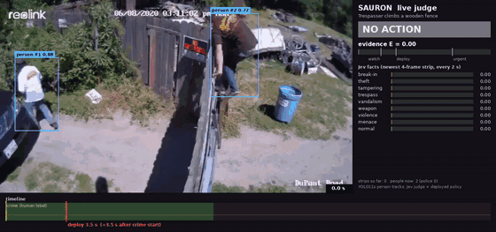
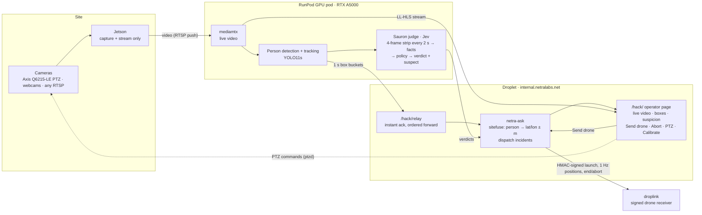

# Sauron — autonomous site security (Netra hackathon, Oct 24 2026)

[](https://github.com/Netra-Internal/sauron-hackathon/actions/workflows/tests.yml)

**Slides:** https://docs.google.com/presentation/d/1DFFL7WKfvFmFfGj1GIm5n_uDdgEpInlzHpR_xEo7hNI/edit?usp=sharing

**Live demo (public, no login):** operator page https://internal.netralabs.net/hack/ ·
site map https://internal.netralabs.net/ask/sites#/site/ucsd-design-innovation-building-c1dd

Sauron watches a site's cameras, decides when a person is doing something that matters, finds where they are on the
map, and sends a drone to them. This repo is everything built for the hackathon in one day, by a team of Claude agents
managed from tmux, on top of Netra's existing stack (netra-ask, the Jetson edge, the dispatch judge).
AI reviewers: start at [AGENTS.md](AGENTS.md).



## Results

Measured today on real footage and real hardware, no per-clip tuning. Every number links to the report it came from.

| claim | number | evidence | code / check |
|---|---|---|---|
| real crime clips that end in a drone deploy | **5/5** | [status/crimevid.md](status/crimevid.md) | [crimevid/run.sh](crimevid/run.sh), videos [media/crimevid/](media/crimevid/) |
| benign clips (owner at own car) that deploy | **0/2** | [status/crimevid.md](status/crimevid.md) | [media/crimevid/owner-car-1.mp4](media/crimevid/owner-car-1.mp4) |
| deploy after the crime starts, fence climb / ATM rip-out | **+3.5 s** | [status/crimevid.md](status/crimevid.md) | [media/crimevid/fence-climb.mp4](media/crimevid/fence-climb.mp4) |
| Jev (VLM judge) cost for the whole clip set | **$0.054** | [status/crimevid.md](status/crimevid.md) | [crimevid/police.py](crimevid/police.py) |
| click on a person → netra-ask accepted the launch | **0.8 s** | [status/launch.md](status/launch.md) | [tools/click_path_test.py](tools/click_path_test.py), `pytest tests/test_launch.py` |
| click → first HMAC-signed launch at the drone receiver | **2.8 s** | [status/launch.md](status/launch.md) | [droplink/droplink.py](droplink/droplink.py), `pytest tests/test_droplink.py` |
| person → coordinate error, leave-one-out median (test rig) | **7.2 m** | [status/calib.md](status/calib.md) | [hackdash/calib.py](hackdash/calib.py), `pytest tests/test_calib.py` |
| PTZ command, browser → camera, median | **~0.5 s** | [status/ptz.md](status/ptz.md) | [ptzd/ptzd.py](ptzd/ptzd.py), `pytest tests/test_ptz.py tests/test_ptz_guard.py` |
| GPU pod running detection + judge (RTX A5000) | **$0.27/h** | [status/cloud.md](status/cloud.md) | [cloud/](cloud/) |

Run the tests: `pip install -r requirements.txt && pytest` (CI above runs the same on every push).

## What it does



<details><summary>Text version</summary>

```
camera (Axis Q6215-LE PTZ, webcams, any RTSP)
   │  video only — the box next to the camera just captures and streams
   ▼
RunPod GPU pod (RTX A5000, $0.27/h)          ← moved off the Jetson today
   person detection + tracking (YOLO11s, the unmodified netra-ask edge code)
   Jev dispatch judge: 4-frame strip every 2 s → facts (break-in, theft, tampering, trespass, weapon, …)
   → policy (evidence E, verdict none / watch / deploy / urgent) → caption + suspect box
   │  1 s buckets of boxes, live video stream
   ▼
droplet (internal.netralabs.net)
   /hack/relay   answers the edge at once, forwards to netra-ask in the background (netra-ask ingest is slow)
   netra-ask     site tracker (sitefuse): every person → lat/lon ± m, from the camera calibration
   /hack/        the operator page: live video + person boxes + suspicion, Send drone, Abort, PTZ, Calibrate
   │  signed webhook (HMAC), retries, 1 Hz position stream, end/abort commands
   ▼
droplink       our drone receiver: verifies and logs exactly what a drone gets (the real drone link is next)
```

</details>

## Details

**Catching real crimes** — [`crimevid/`](crimevid/), videos in [`media/crimevid/`](media/crimevid/). Same judge code and
default policy as the Jetson deployment; police are classified separately and never picked as the suspect.

| clip | Sauron deploys | after the crime starts |
|---|---|---|
| fence climb (clean CCTV) | yes | **+3.5 s** |
| ATM rip-out | yes | +3.5 s |
| bike lock cut (news banner cropped) | yes | +5.5 s, before police arrive |
| catalytic converter theft | yes | +11.5 s (slow) |
| car break-in (night, tiny figures) | yes | +12.5 s (slow) |
| owner at own car ×2 (benign) | never | — |

5/5 crimes caught, 0/2 false launches. Jev cost for the whole set: $0.05.

**Send drone from the dashboard** ([`hackdash/launch.py`](hackdash/launch.py), [`droplink/`](droplink/), test
[`tools/click_path_test.py`](tools/click_path_test.py)), on real passers-by:
- click on a person → netra-ask accepted 0.8 s → first signed launch at the receiver 2.8 s; a second click on the same
  person returns the same incident;
- abort → `end` → closed → `abort`, with no open update after the abort (a bug the first test caught, fixed same hour).

**Person → coordinate** ([`hackdash/calib.py`](hackdash/calib.py), [`hackdash/static/calib.js`](hackdash/static/calib.js)):
freeze a frame, click frame↔map point pairs, fit the camera pose (netra-ask camgeo) with a multi-start search; the
honest error is leave-one-out metres (C920 test rig: ±7 m). PTZ cameras store pan/tilt/zoom with the calibration.

**PTZ** ([`hackdash/ptz.py`](hackdash/ptz.py), [`ptzd/`](ptzd/)): hold-to-move, zoom, click-to-centre, home, day/night;
~0.5 s browser → camera. Operator-only: the agents' service account cannot move the camera.

**Edge → cloud** ([`cloud/`](cloud/)): the Jetson only captures; detection runs on the RunPod pod and the Jetson GPU is
free for the drone. Adding a camera = one stream entry.

## Layout

| path | what |
|---|---|
| `hackdash/` | the `/hack/` service: app, live boxes (`live.py`), edge relay (`relay.py`), launch, calibrate, PTZ, page (`static/`) |
| `droplink/` | signed drone-message receiver |
| `ptzd/` | tiny VAPIX proxy next to the camera (allow-listed commands) |
| `cloud/` | Jetson → pod video push, pod edge supervisor, stream proxy |
| `crimevid/` | crime-clip pipeline: prep/crop, real judge replay, police classifier, annotated render, results page |
| `deploy/` | droplet install script, unit, nginx blocks |
| `tools/` | end-to-end checks (click path, calibration round trip, PTZ) and `hagent` (spawn/steer agents in tmux) |
| `plans/`, `ARCH.md` | the click-to-dispatch plan and the API contract the agents built against |
| `briefs/`, `status/`, `COMMON.md` | how the agent team was run: one brief per agent, their reports, the shared rules ([docs/how-we-built-it.md](docs/how-we-built-it.md)) |
| `tests/`, `.github/workflows/` | unit tests (no network, no camera) and the CI that runs them |
| [`AGENTS.md`](AGENTS.md), [`llms.txt`](llms.txt) | a map of the repo for AI reviewers |
| `media/` | annotated crime videos and screenshots |

